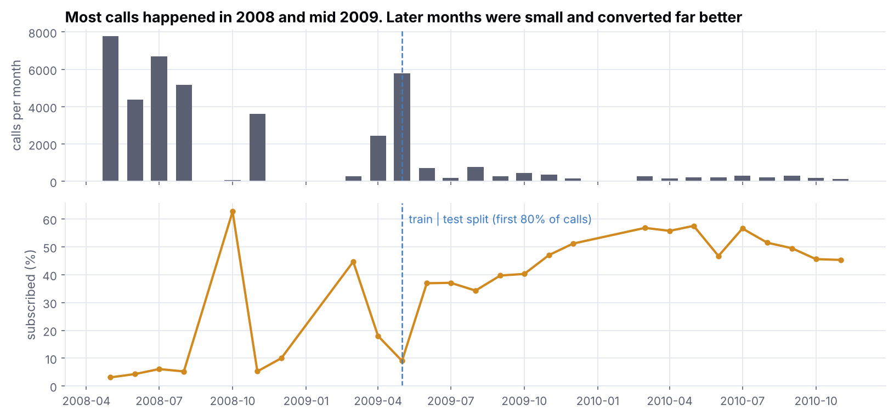
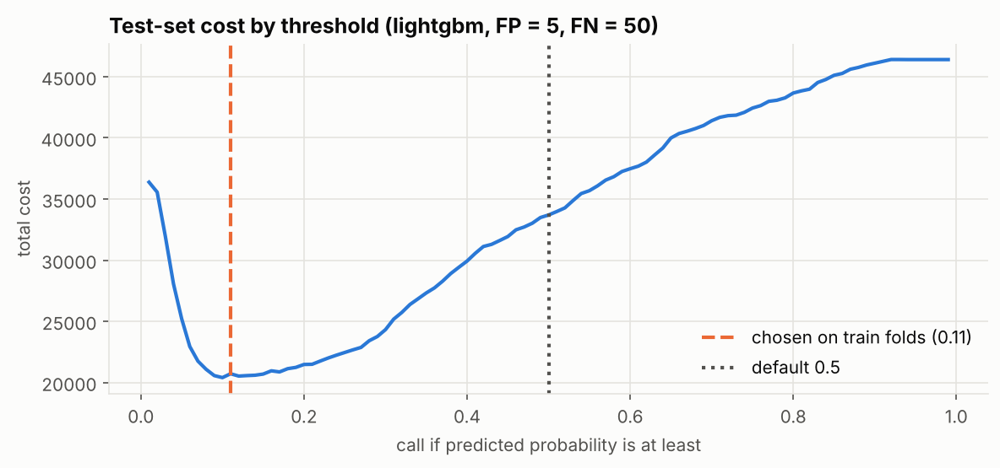
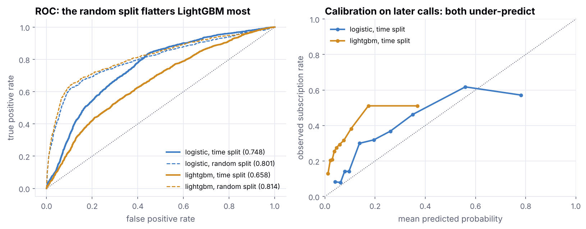
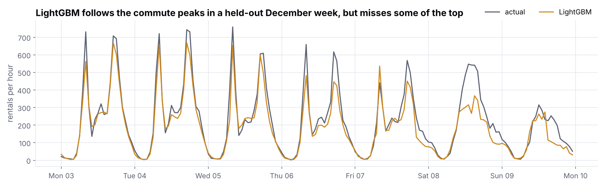
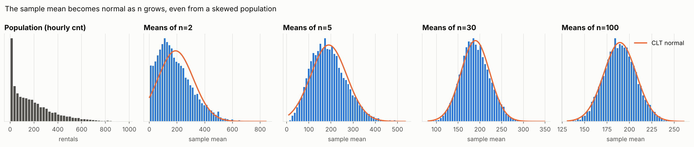

# Statistics and Modeling

Built in 2026 on public UCI datasets.

I use this repo to work through the statistics and modeling I'd expect to be asked about in an interview, on two real datasets. There are six notebooks, executed with outputs saved, and a small tested Python package in `src/`. Every number below comes from code in this repo.

## The short version

The bank model is the part I'd point a hiring manager to, mostly because of what went wrong with it. On the usual random split LightGBM scores a test ROC-AUC of 0.814. Trained on the first 80% of calls (May 2008 to May 2009) and tested on the rest, the model I picked scores 0.701, the best of the four I tried scores 0.748, and LightGBM drops to 0.658. Conversion went from 6.37% to 30.83% between the two periods, and at my assumed call costs no model threshold beats simply calling everyone. The time split is the honest number, so that's what I report.



## What's in here

| Notebook | What I do in it |
|---|---|
| [01 EDA](notebooks/01_eda_descriptive_stats.ipynb) | Distributions, outliers, correlation, class imbalance, and why `duration` and `casual`/`registered` have to go |
| [02 Probability and sampling](notebooks/02_probability_and_sampling.ipynb) | CLT by simulation, CI coverage, bootstrap CIs |
| [03 Hypothesis testing](notebooks/03_hypothesis_testing.ipynb) | Welch t, Mann-Whitney, chi-square, ANOVA with Tukey, a season-adjusted check with HAC errors, power, multiple testing, A/B test planning and peeking |
| [04 Regression](notebooks/04_regression_bike_sharing.ipynb) | Daily OLS with diagnostics and Newey-West errors, then hourly ridge, lasso and LightGBM on a chronological holdout |
| [05 Classification](notebooks/05_classification_bank_marketing.ipynb) | Time-ordered evaluation, macro columns as a time proxy, a cost-based threshold with a sensitivity check, the random split for reference |
| [06 Model card](notebooks/06_model_card_summary.ipynb) | Reads the saved results and lists what works, what doesn't, and the limits |

## Data

| Dataset | Used for | Source | License |
|---|---|---|---|
| Bike Sharing (Fanaee-T, 2013). Capital Bikeshare, Washington DC, 2011 to 2012. 731 days, 17,379 hours. | Regression, sampling, tests | [UCI ML Repository, id 275](https://archive.ics.uci.edu/dataset/275/bike+sharing+dataset), DOI 10.24432/C5W894 | CC BY 4.0 |
| Bank Marketing (Moro, Rita and Cortez, 2014). Portuguese bank phone campaigns, May 2008 to Nov 2010, `bank-additional-full.csv`, 41,188 calls. | Classification, tests | [UCI ML Repository, id 222](https://archive.ics.uci.edu/dataset/222/bank+marketing), DOI 10.24432/C5K306 | CC BY 4.0 |

Raw files are not committed. `scripts/download_data.py` fetches them from UCI into `data/raw/`.

## Classification: term deposit subscription

I dropped `duration` because call length is only known after the call ends. The file has no dates, but it is in call order and `month` only moves forward, so I rebuilt the calendar month of each call. That's how I found that `nr_employed` takes exactly one value per month. It's a month label in disguise, and the other macro columns are close to it.

Trained on the first 80% of calls, tested on the last 20% (8,238 calls):

| Model | Test ROC-AUC | Within-month ROC-AUC | Mean predicted | Actual rate | Random-split ROC-AUC |
|---|---|---|---|---|---|
| Logistic regression | 0.748 | 0.629 | 0.256 | 0.308 | 0.801 |
| Logistic, no macro columns | 0.701 | 0.635 | 0.175 | 0.308 | 0.765 |
| LightGBM | 0.658 | 0.618 | 0.093 | 0.308 | 0.814 |
| LightGBM, no macro columns | 0.681 | 0.615 | 0.164 | 0.308 | 0.782 |

A few things I take from this:

- Every model loses 0.05 to 0.16 of ROC-AUC when moved from a random split to a time split. The macro columns add 0.031 to LightGBM on the random split and cost it 0.023 on the time split, which is what a time proxy looks like.
- Within-month ROC-AUC scores the ranking inside each test month, which is the decision the bank actually makes. It is about 0.62 to 0.64 for every model, so most of the pooled score comes from telling months apart.
- Time-series CV inside the first year was close to chance for all four models (0.494 to 0.547). It picked "logistic, no macro" by a hair, and I stuck with that rather than pick the test-set winner afterwards.

The costs are an assumption. I don't have the bank's numbers, so I assumed a wasted call costs 5 and a missed subscriber costs 50. I picked the threshold on the last block of the training period and applied it once to the test calls:

| Policy | Calls | Subscribers reached (of 2,540) | Total cost |
|---|---|---|---|
| Default threshold 0.5 | 889 | 462 | 106,035 |
| Threshold 0.06, picked on earlier data | 5,460 | 2,071 | 40,395 |
| Call everyone | 8,238 | 2,540 | 28,490 |

Calling everyone wins. The validation block converted at 12.7% and the test period at 30.8%, and when almost a third of people say yes and a miss costs ten times a call, you call nearly everyone. I tried five cost pairs (5/25, 5/50, 5/100, 2/50, 10/50) and the model policy never beat calling everyone. At best it tied, and at worst it cost 42% more. Even with hindsight, the best threshold on the test calls saves 55 out of 28,490.



On the random split, for reference, LightGBM gets ROC-AUC 0.814 and PR-AUC 0.495, and class weighting leaves ranking the same (0.801) while wrecking calibration (Brier 0.077 to 0.162). Notebook 5 has those tables, calibration curves and SHAP.



## Regression: hourly bike rentals

Daily OLS (731 days) has R squared 0.851. Residuals are autocorrelated (Durbin-Watson 1.210), so I report Newey-West standard errors, which are up to 2.08 times the plain OLS ones. Predicted rentals peak at about 27.6 C.

For the hourly model I trained on Jan 2011 to Sep 2012 and tested on the 2,168 hours of Oct to Dec 2012. `casual` and `registered` sum to the target, so they are out (there's an assert). I didn't use lagged demand. An hour-old count is only fair if the model runs one hour ahead, and every feature here is known from the calendar or the weather. The weather is the actual weather of that hour, so a real forecast would do worse.

| Model | RMSE | MAE | R squared |
|---|---|---|---|
| Baseline (hour x working-day mean) | 119.59 | 79.95 | 0.648 |
| Ridge | 70.08 | 43.40 | 0.879 |
| Lasso | 70.38 | 44.24 | 0.878 |
| LightGBM | 66.66 | 42.20 | 0.891 |

Every test month is under-predicted on average (October by about 28 rides an hour) because ridership kept growing and the model only sees growth through a year flag.



## Statistics

- Hourly rental counts have skew 1.277. By n = 30 the sample mean is close to normal, and its spread matches sigma over root n (33.29 measured vs 33.12 predicted). Over 2,000 samples of n = 50, t intervals covered the true mean 95.3% of the time, and percentile bootstrap intervals for the median covered 94.3%.
- Working days vs days off: the plain Welch test says no difference (p = 0.11, d = 0.132). I don't trust it on its own. Daily counts have lag-1 autocorrelation 0.849 and most of the spread is season and growth. Holding season and year fixed with HAC errors, working days come out 190.8 rides a day higher (p = 0.048, 95% CI 1.3 to 380.2). Adding weather (notebook 4) shrinks it to about 105 (p = 0.128). My reading is a small bump at most, so plan around the hourly shapes instead.
- Casual riders are much busier on days off (median 1,338 vs 616, Mann-Whitney p = 3.79e-29, rank-biserial r = 0.515).
- Mobile contacts subscribed at 14.74% vs 5.23% on a landline (chi-square p = 1.53e-189, Cramer's V = 0.145). That's an association, since mobile and landline clients differ in other ways.
- With 20 pure-noise features, 64.6% of rounds had at least one false hit at raw p < 0.05. Benjamini-Hochberg cut that to 5.8% and Bonferroni to 5.6%.
- To detect 11.27% to 12.77% at alpha 0.05 and 80% power needs 7,375 per arm. In 5,000 simulations the false positive rate was 0.0524 and power 0.7902. Peeking 10 times raised the false positive rate to 0.1975.



## How to run

Tested with Python 3.13 on Linux. Needs `make`.

```bash
make all        # venv + pinned install, download data, lint, run tests, execute all notebooks in order
```

Or step by step:

```bash
make setup      # create .venv and install requirements.txt
make data       # download the UCI files into data/raw/
make lint       # ruff
make test       # pytest on src/
make notebooks  # execute every notebook in place with nbconvert
```

A full `make all` takes about 10 minutes on a 4-core machine, most of it notebooks 3 to 5. All randomness is seeded (`src.SEED = 42`). CI runs ruff and pytest on every push, using only tiny CSVs built inside the tests, so it needs no download.

## Layout

```
notebooks/            numbered, executed notebooks
src/
  data.py             loaders for both datasets (unit conversion, pdays flag, duration drop)
  stats_utils.py      effect sizes, bootstrap CI, IQR outliers, two-proportion sample size
  modeling.py         VIF, time splits, within-month AUC, regression metrics, cost thresholds and sensitivity
  plotting.py         one chart style for every figure (amber highlight, blue second series)
tests/                pytest tests for src/
scripts/download_data.py
results/              metrics written by notebooks 4 and 5, read by notebook 6
docs/img/             charts used in this README
```

## Citations

- Fanaee-T, H. (2013). Bike Sharing. UCI Machine Learning Repository. https://doi.org/10.24432/C5W894
- Moro, S., Rita, P., and Cortez, P. (2014). Bank Marketing. UCI Machine Learning Repository. https://doi.org/10.24432/C5K306
- Moro, S., Cortez, P., and Rita, P. (2014). A data-driven approach to predict the success of bank telemarketing. Decision Support Systems, 62, 22 to 31.

## License

Code is MIT licensed, see [LICENSE](LICENSE). The datasets belong to their authors and are used under CC BY 4.0.
